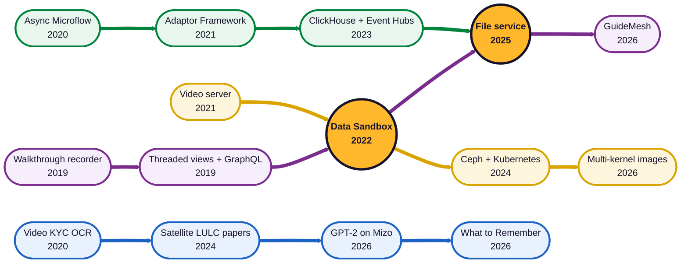

  

  <a href="https://swarup.me">
    <picture>
      <source media="(prefers-color-scheme: dark)" srcset="https://readme-typing-svg.demolab.com?font=JetBrains+Mono&weight=600&size=20&duration=3200&pause=900&color=F2C230&amp;center=true&vCenter=true&width=640&height=40&lines=Lead+Engineer+%40+Centre+of+Data+for+Public+Good;Backend+%C2%B7+DevOps+%C2%B7+Streaming+pipelines+%C2%B7+Data+platforms;Flink+%C2%B7+Kubernetes+%C2%B7+ClickHouse+%C2%B7+Go+%C2%B7+TypeScript;M.Tech+(Online)+%40+IISc+%C2%B7+since+Aug+2025" />
      
    </picture>
  </a>

  
  
  
  
  
  

I'm Lead Engineer at the **Centre of Data for Public Good** in Bengaluru. I build backend services, streaming pipelines and data platforms, run the Kubernetes infrastructure under them, and ship the front ends on top. Since Aug 2025 I'm also on the online M.Tech in Data Science and Business Analytics at IISc.

## 🚇 The line map

Every station is something I built. Lines are kinds of work, interchanges are projects that sit on two.

  🟣 <b>Product & UI</b> &nbsp; 🟡 <b>Platform & Infra</b> &nbsp; 🟢 <b>Streaming & Data</b> &nbsp; 🔵 <b>Research</b> &nbsp; 🟠 <b>Interchange</b>

## 🛠️ What I've built

| | Project | What it does |
|:-:|---|---|
| 🟢 | **IUDX Adaptor Framework** | Flink pipeline that pulls city data, transforms it and streams it into the exchange. I wrote the Calcite SQL rules engine over RocksDB state. Top contributor, 178 of 435 commits. |
| 🟡🟣 | **IUDX Data Sandbox** | Jupyter notebooks next to the exchange's datasets. Go API with Keycloak auth, build progress over Server-Sent Events, JupyterHub and BinderHub on Kubernetes. |
| 🟢 | **Analytics at volume** | ClickHouse clusters holding billions of rows that answer in under a second, fed by Azure Functions and Event Hubs. |
| 🟣🟢 | **Data marketplace file service** | S3 and MinIO multipart uploads, presigned URLs, policy checks, and in-browser Parquet previews through DuckDB. |
| 🟡 | **Multi-kernel notebook images** | Python, R, Julia and Scala in one Jupyter image. Cut the CPU image from 16.1 GB to 8.1 GB and the GPU image from 38.9 GB to 26.5 GB. |
| 🟡 | **IUDX Video Server** | Proxies live camera feeds from city servers behind NAT out to the cloud. |

<b>📄 Papers</b>

 

- [An Atmospheric Correction Integrated LULC Segmentation Model for High-Resolution Satellite Imagery](https://doi.org/10.1109/InGARSS61818.2024.10984371), IEEE InGARSS 2024
- [Cross Pseudo Supervision Framework for Sparsely Labelled Geospatial Images](https://arxiv.org/abs/2408.02382), arXiv 2024
- [Performance Evaluation of Geospatial Images based on Zarr and Tiff](https://arxiv.org/abs/2411.11291), arXiv 2024
- [Comparison of Segmentation Methods in Remote Sensing for Land Use Land Cover](https://arxiv.org/abs/2507.18099), arXiv 2025

<b>🧪 At IISc and in my own workshop</b>

 

- **Learning What to Remember**: which frames should a vision-language model keep from a long video before it knows the question? Reproduced the SimpleStream baseline, then reported honestly that the learned memory did not beat it.
- **GPT-2 on Mizo**: fine-tuned GPT-2 on a low-resource language, test perplexity 680 to 22.5.
- **GuideMesh**: record a browser workflow, get a product walkthrough that survives code changes (37 of 38 steps still found after 50 commits).
- **videopipe** and **agent-skills**: videos written as code, and 30 skills for Claude Code and Codex.

## 🧰 Stack

   
   
  

  
  
  
  
  
  
  
  

## 📈 Activity

  <picture>
    <source media="(prefers-color-scheme: dark)" srcset="https://streak-stats.demolab.com/?user=swarupe&theme=tokyonight&hide_border=true&background=0D111700&ring=F2C230&fire=F2C230&currStreakLabel=F2C230" />
    
  </picture>

  

